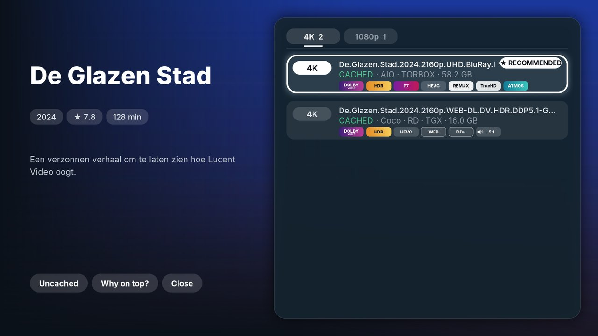
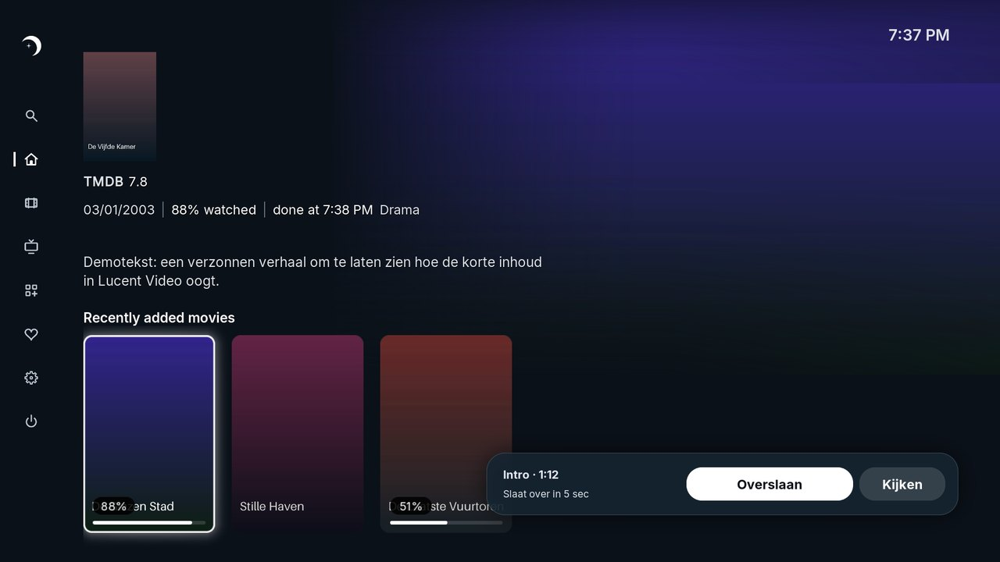
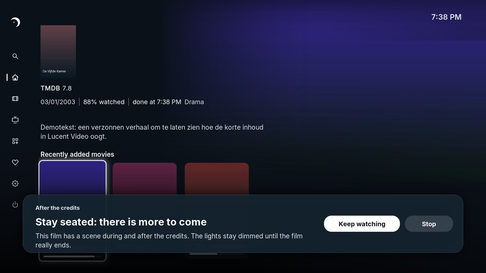
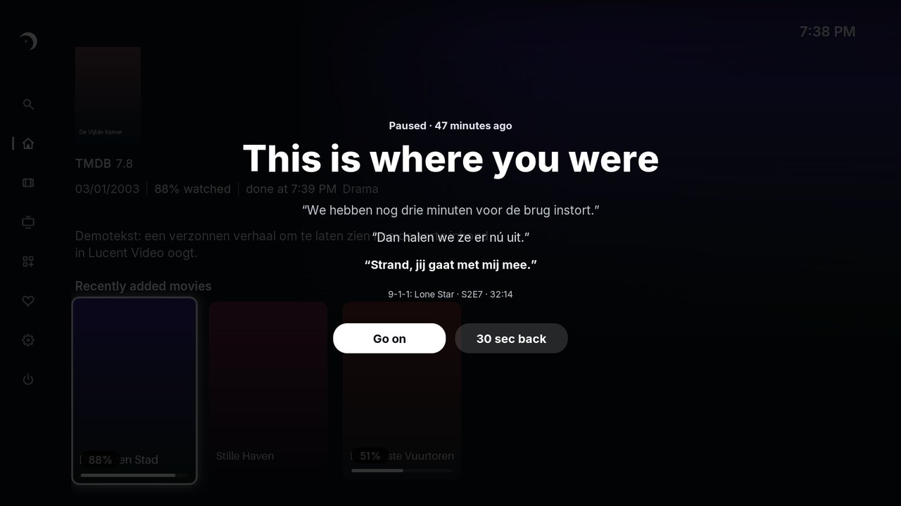
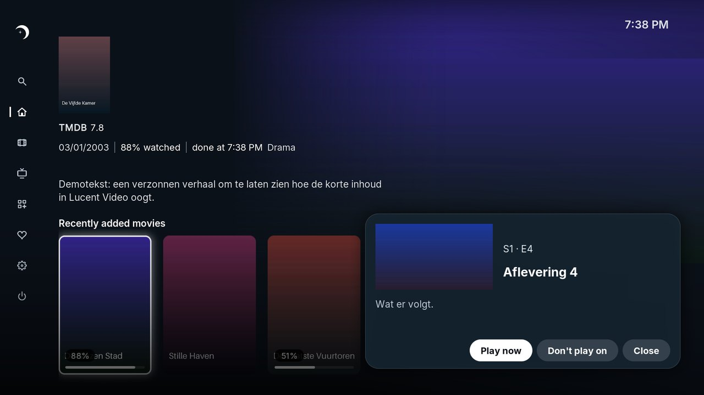
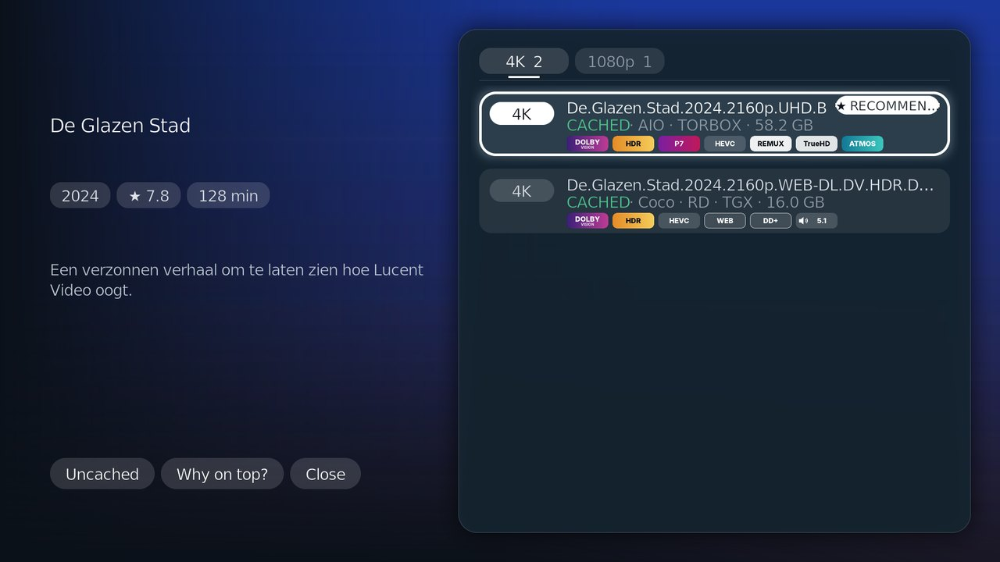
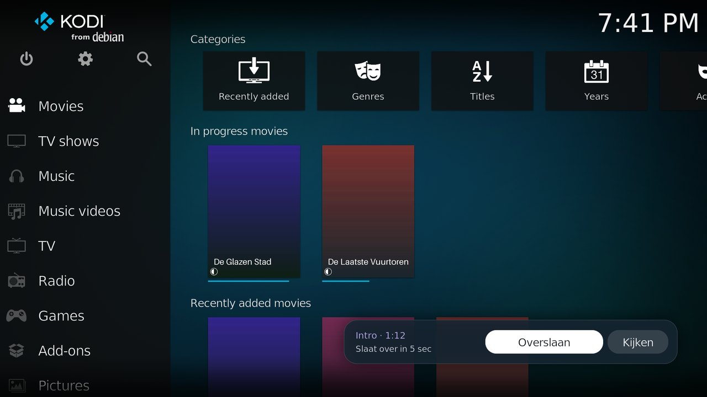
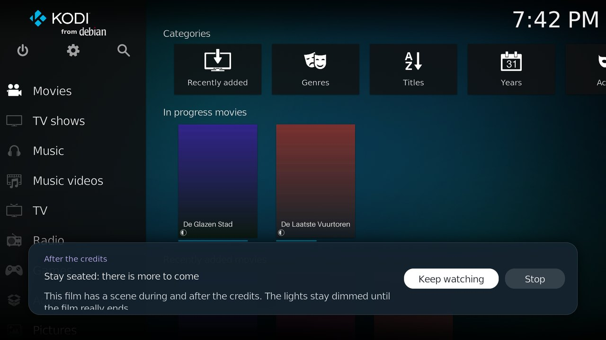
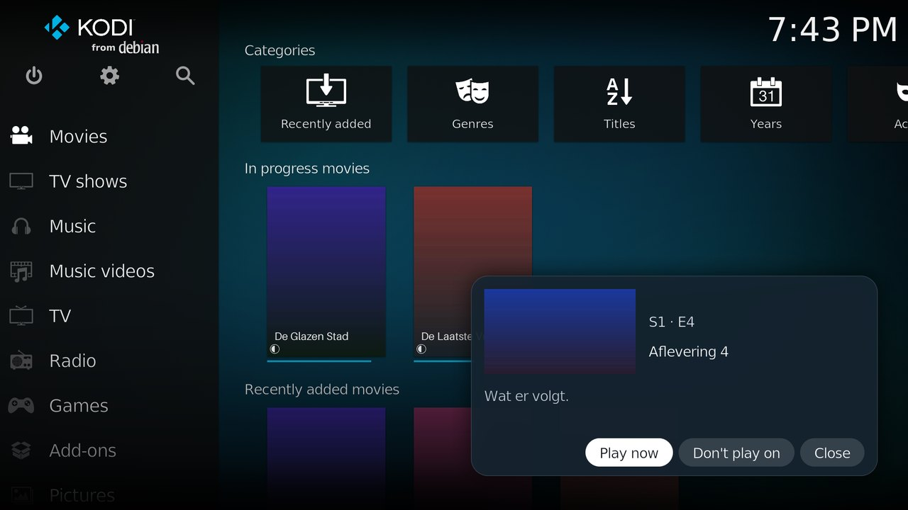
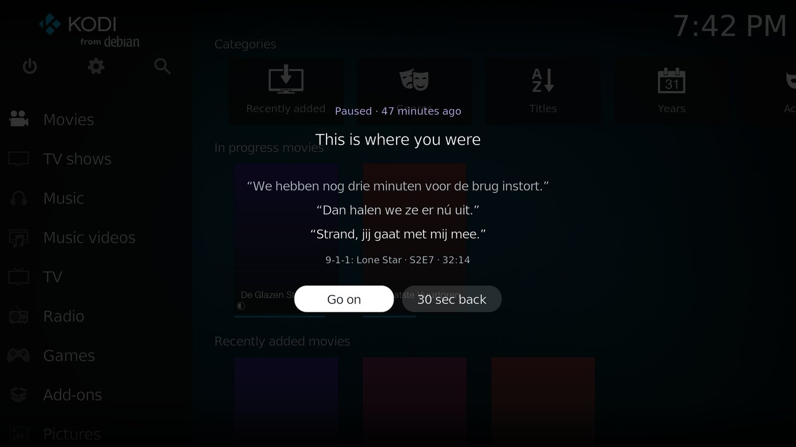

  

<h1 align="center">Lucent Video</h1>

  Movies and series for Kodi – made for the <a href="https://github.com/djdirty60/Lucent">Lucent</a> skin, working in any skin. 
  <b>1.0.0 beta 1</b> · Kodi 20 and newer · MIT licence

  

---

## What it does

**Browse**
- Trending, popular, top rated, now playing, decades, genres, studios and awards (Oscars, Emmys, Palme d'Or) – all from TMDB.
- Streaming services, a calendar of new episodes, new seasons announced, and *coming soon* from your watchlist.
- **Kompas** learns from your ratings and suggests what to watch. *What shall we watch?* helps when you can't decide.

**Play**
- With your own sources: an AIOStreams address, Easynews, TorBox, Real-Debrid, AllDebrid, Premiumize, or the scraper packs CocoScrapers, FenomScrapers and OpenScrapers. Lucent Video ships no sources of its own.
- **Smart ranking.** Picture comes first (resolution, Dolby Vision, HDR, IMAX), then sound (Atmos, TrueHD, channels). Red flags always go to the bottom, and *Why on top?* explains the choice.
- Sources for the next episode, or for *tonight*, are looked up beforehand, so playback starts at once.

**While watching**
- **Skip intro, recap, preview and credits** with TheIntroDB, and a button to report a missing intro.
- **Stay seated:** a card tells you when a film has a scene during or after the credits.
- **Pause recap:** after a long pause it shows the last lines that were said.
- **Next episode** card at the credits.
- **Built-in subtitles** from OpenSubtitles, SubDL and Podnapisi, with no separate subtitle add-on needed. It picks one by itself, can show two at once, and has *What did they say?* (10 seconds back, with subtitles).

**Keep track**
- Trakt or Simkl: scrobbling, watchlist, lists, continue watching and next up. Without an account it keeps track on this device only.
- MDBList and Floppy lists, and you choose which lists you see.
- Rows for your Home screen in any skin, filled and refreshed by themselves.

**Extras**
- **Homey movie night:** lights down when a film starts, slowly up at the credits. See [README-HOMEY.md](README-HOMEY.md) (Nederlands: [LEESMIJ-HOMEY.md](LEESMIJ-HOMEY.md)).
- Type with your phone, a marathon planner, your year of watching, and backups of your settings.

  
  
   
  
  

---

## Install

**The easy way: add a source in Kodi**
1. In Kodi go to **Settings → File manager → Add source**.
2. Choose **<None>**, type `https://djdirty60.github.io/Lucent-video/`, and name it **Lucent**.
3. Go to **Add-ons → Install from zip file → Lucent → repository.lucent.zip**.
4. Go to **Add-ons → Install from repository → Lucent Repository → Video add-ons → Lucent Video → Install**.

**Or with the zip file**
1. Download [`repository.lucent.zip`](https://github.com/djdirty60/Lucent/raw/main/repository.lucent.zip) and copy it to your device.
2. In Kodi go to **Add-ons → Install from zip file** and choose `repository.lucent.zip`.
3. Go to **Add-ons → Install from repository → Lucent Repository → Video add-ons → Lucent Video → Install**.

Installing from zip needs **Settings → System → Add-ons → Unknown sources** switched on.

When you open Lucent Video, a setup assistant walks you through the TMDB key, your sources and your account. Kodi keeps Lucent Video up to date through the Lucent Repository.

**You need:**
- a free TMDB API key;
- at least one source from the list above;
- optionally a Trakt or Simkl account.

## Other skins

Lucent Video is made for the Lucent skin, but its own windows (choosing a source, skip intro, subtitles …) also work in other skins. Outside Lucent they use fixed colours and common fonts, so they look a little simpler.

This is how it looks in **Estuary**, Kodi's default skin:

  
  
   
  
  
   
  

## Privacy

Lucent Video runs on your own device and has no server. Keys and sign-in tokens stay in Kodi's add-on data folder and are never written to the log.

Lucent uses Trakt but is not endorsed or certified by Trakt. Film and series data come from TMDB; this product uses the TMDB API but is not endorsed or certified by TMDB.

## Feedback

It's a beta, so please report bugs and ideas in the [issues of the Lucent repository](https://github.com/djdirty60/Lucent/issues).

## Made with AI

Lucent Video is designed and tested by Wilfried van der Voort (djdirty60). The code was written with the help of Claude, an AI by Anthropic.

---

<b>For developers</b>

- `plugin.video.lucent/` – the add-on itself.
- `repo/` – the Kodi repository folder that the Lucent Repository reads.
- The public actions for other add-ons and skins are listed in [plugin.video.lucent/README.md](plugin.video.lucent/README.md).

**Publishing a new version**

1. Put the new add-on folder (with `icon.png`) somewhere, for example `/tmp/plugin.video.lucent`.
2. Run `python3 tools/build_repo.py /tmp/plugin.video.lucent .`. This copies the source and rebuilds `repo/`.
3. Check that no keys or tokens are in the change, then commit and push to `main`.
4. Kodi picks up the new version through the Lucent Repository by itself.

